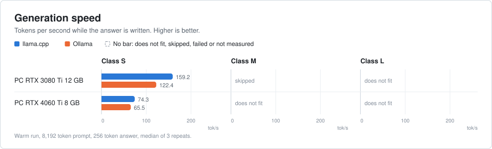
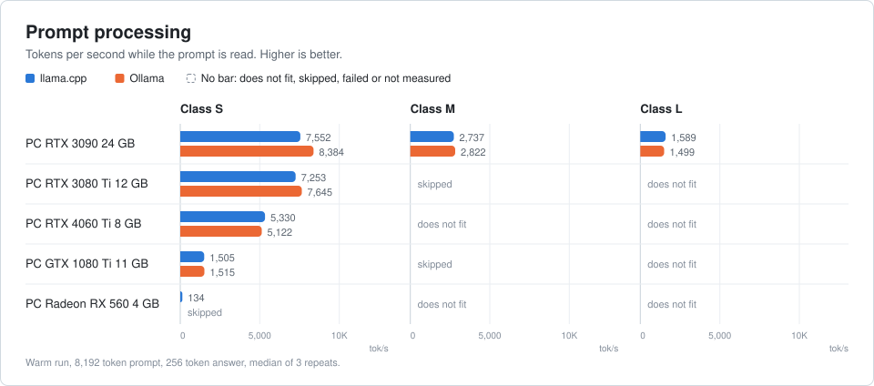
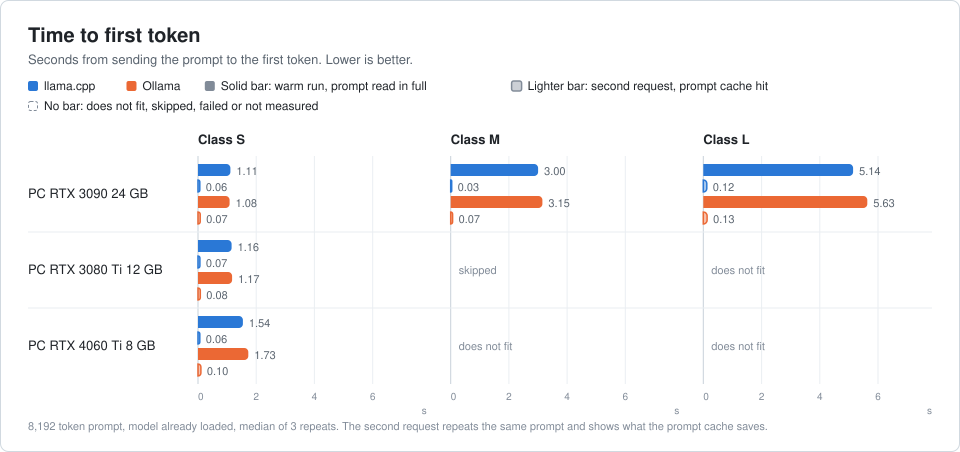
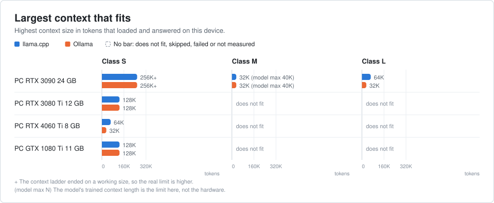
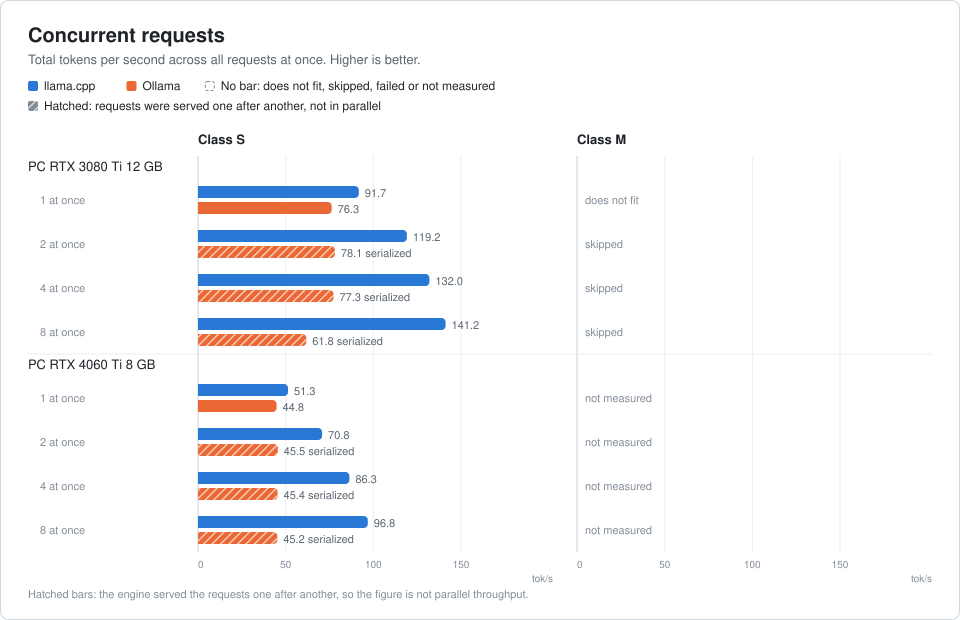
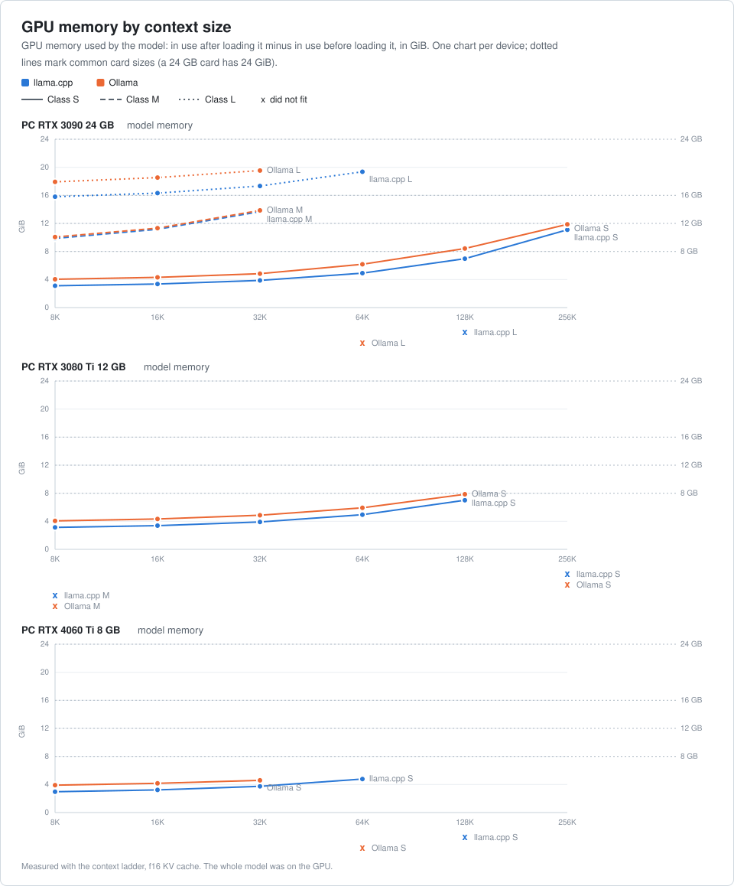
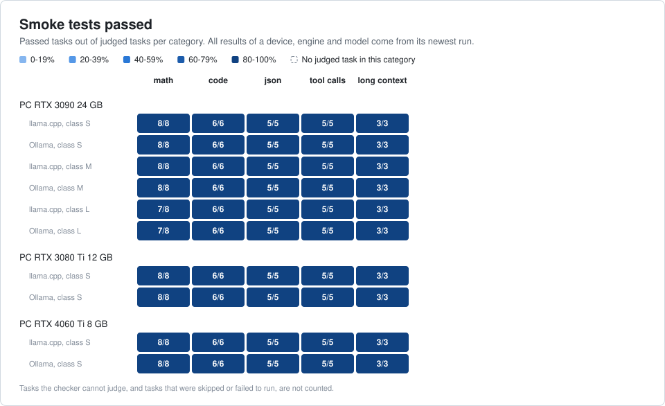

# LLM Benchmarks

Local language models on real hardware, measured the same way on every device. The input is English text from 25 pinned Wikipedia articles, the answer is 256 tokens long, and the speed values are the median of three runs. **Prompt processing** shows how fast a document is read. **Generation** shows how fast the answer is written. Other suites measure memory use per context size, small quality checks (smoke tests) and parallel requests.

Everything runs through one program, `bench`. It starts the engines itself (Ollama and llama.cpp), checks that the model fits, saves after every single test, and writes a report you can send as a pull request.

## Results

<!-- generated:charts -->
### Generation speed

Tokens per second while the answer is written, warm run, 8,192 token prompt.

<picture>
  <source media="(prefers-color-scheme: dark)" srcset="charts/generation-dark.svg">
  
</picture>

### Prompt processing

Tokens per second while the prompt is read, warm run, 8,192 token prompt.

<picture>
  <source media="(prefers-color-scheme: dark)" srcset="charts/prompt-processing-dark.svg">
  
</picture>

### Time to first token

Seconds until the first token, warm run, 8,192 token prompt. Lower is better.

<picture>
  <source media="(prefers-color-scheme: dark)" srcset="charts/ttft-dark.svg">
  
</picture>

### Largest context

Highest context size that loaded and answered. A plus sign means the ladder ended before a limit was found.

<picture>
  <source media="(prefers-color-scheme: dark)" srcset="charts/max-context-dark.svg">
  
</picture>

### Concurrent requests

Total tokens per second with several requests at once. Hatched bars were served one after another and are not parallel throughput.

<picture>
  <source media="(prefers-color-scheme: dark)" srcset="charts/concurrency-dark.svg">
  
</picture>

### Memory

GPU memory in use per context size and device. Dotted lines mark 8, 12, 16 and 24 GB cards.

<picture>
  <source media="(prefers-color-scheme: dark)" srcset="charts/memory-dark.svg">
  
</picture>

### Smoke tests

Passed tasks out of judged tasks per category. The newest result per device, engine and model counts.

<picture>
  <source media="(prefers-color-scheme: dark)" srcset="charts/smoke-dark.svg">
  
</picture>
<!-- /generated:charts -->

## Test runs

Each run has its own folder with a report and the raw results:

<!-- generated:runs -->
- [2026-10-26: MacBook Pro M5 Max 128 GB](runs/2026-10-26-macbook-pro-m5-max-128gb/), old prompt
- [2026-10-26: PC RTX 3090 24 GB](runs/2026-10-26-pc-rtx-3090-24gb/), old prompt
- [2026-10-26: PC RTX 4060 Ti 8 GB](runs/2026-10-26-pc-rtx-4060-ti-8gb/), old prompt
- [2026-10-28: PC RTX 3090 24 GB](runs/2026-10-28-pc-rtx-3090-24gb/), old prompt
- [2026-10-30: PC RTX 3090 24 GB](runs/2026-10-30-pc-rtx-3090-24gb/), old prompt
- [2026-10-31: PC Radeon RX 560 4 GB](runs/2026-10-31-pc-radeon-rx-560-4gb/), old prompt
- [2026-11-02: PC RTX 3090 24 GB](runs/2026-11-02-pc-rtx-3090-24gb/), old prompt
- [2026-11-02: PC RTX 4090 24 GB](runs/2026-11-02-pc-rtx-4090-24gb/), old prompt
- [2026-11-03: PC RTX 3080 Ti 12 GB](runs/2026-11-03-pc-rtx-3080-ti-12gb/), llama.cpp and Ollama; classes S, M, L; speed, memory, smoke, concurrency
- [2026-11-03: PC RTX 4060 Ti 8 GB](runs/2026-11-03-pc-rtx-4060-ti-8gb/), llama.cpp and Ollama; classes S, M, L; speed, memory, smoke, concurrency
<!-- /generated:runs -->

Runs marked "old prompt" were measured by hand with an earlier version of the benchmark. They are not part of the charts. Each one is replaced by a new run once the device has been measured again.

## Platforms

| Platform | Status |
|:--|:--|
| Windows + NVIDIA (CUDA) | tested |
| Linux + AMD (Vulkan) | being tested |
| macOS + Apple Silicon (Metal) | untested |
| Linux or Windows + AMD (ROCm) | untested |

"Untested" means the code has a path for it, but no run exists yet. A run from such a machine is very welcome.

## Run it yourself

You do not need to install Python. The launcher, `bench.sh` (macOS, Linux) or `bench.ps1` (Windows), finds `uv` or downloads it into `.bench/`. It needs no admin rights and changes no system settings.

```text
./bench.sh doctor
./bench.sh plan --models S,M
./bench.sh run --models S,M
./bench.sh report
```

On Windows use `.\bench.ps1` instead of `./bench.sh`.

- `doctor` checks uptime, open programs, monitors and driver settings. It changes nothing.
- `plan` shows which models fit into GPU memory, how long the run takes and which combinations are new.
- `run` measures. A run continues where it stopped: tests that are done are skipped. `--force-test <pattern>` measures matching tests again, for example `--force-test "llamacpp/S/speed/*"`.
- `--no-code-exec` skips the smoke tasks that run code written by the model. To measure them later, run again without it and add `--force-test "*/smoke/code-*"`.
- `report` writes `README.md` from `results.json` in the run folder. `run` does this at the end too.

Lists are comma separated: `--engines ollama,llamacpp`, `--models S,M,L`, `--suites speed,memory,smoke`. In PowerShell you can type them without quotes.

The results go to `runs/<date>-<device>/`. Engine logs stay in `.bench/logs` and never leave the machine. `bench report` refuses to write when it finds private data such as user names, host names, IP addresses or paths. Fix the file it names and run it again.

`bench` only stops processes it started itself. It never deletes models and never changes system settings. If a model does not fit into free GPU memory, that test is stored as `does_not_fit` and the run goes on. Only a GPU driver reset ends the run. What was saved stays.

## Contributing

Results from more devices are welcome, even one model on one engine. See [CONTRIBUTING.md](CONTRIBUTING.md). The short way is the prompt below.

## License

Everything in this repository, results, texts and scripts, is licensed under [CC BY 4.0](LICENSE).

## Agent prompt

Paste this into Claude Code or a similar agent on the machine you want to test.

```text
You are helping me add a benchmark run to https://github.com/maluramichael/llm-benchmarks.
Work in a fresh clone of that repository. Ask me before you install anything.

1. Prepare the machine. Ask me to restart it and to close other programs
   (browsers, Docker, chat apps). Unplug extra monitors if possible.
2. Run `./bench.sh doctor` (Windows: `.\bench.ps1 doctor`). Show me every
   warning and help me fix what is safe to fix. Do not change system
   settings without asking me.
3. Run `./bench.sh plan`. Show me the table: what fits, how long it takes,
   which combinations are new. Let me choose engines, models and suites.
   Lists are comma separated, for example `--engines ollama,llamacpp --models S,M`.
4. Run `./bench.sh run` with my choices. Report progress after each model.
   If it stops, run the same command again: it continues where it stopped.
   Use `--force-test <pattern>` only if I ask to measure something again.
5. Run `./bench.sh report`. If it refuses because of private data, fix the
   file it names and run it again. Never copy engine logs from `.bench/logs`.
6. Open a pull request with the new folder under `runs/`. Add nothing else.
   Do not edit the generated parts of README.md or charts/.
```
